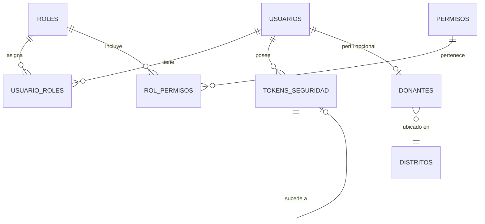
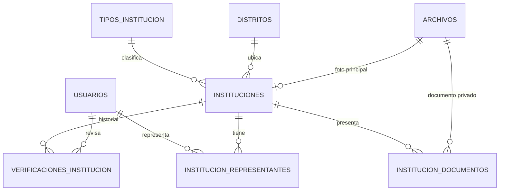
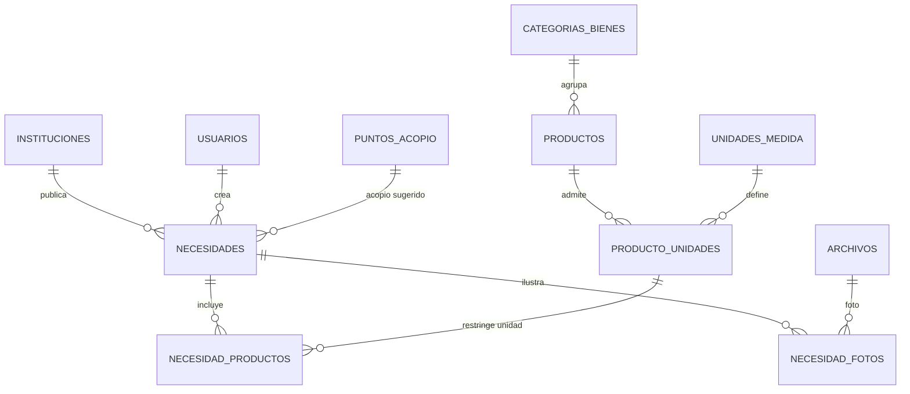
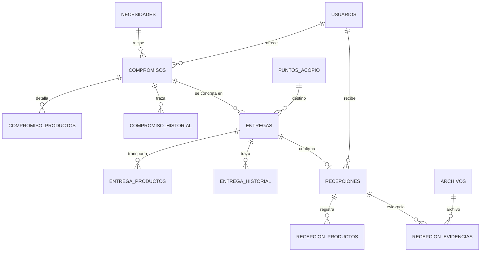
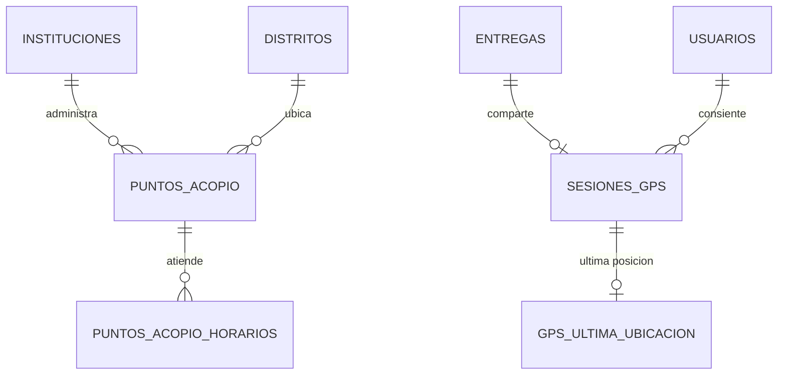
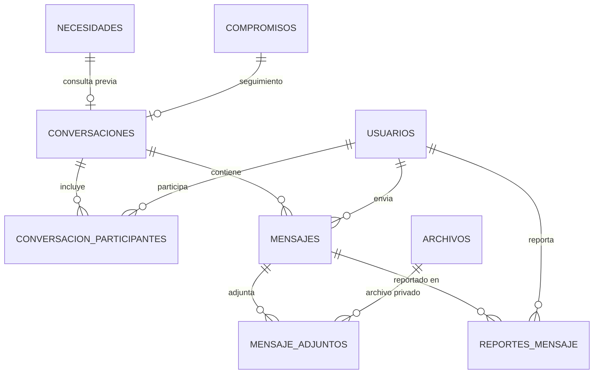
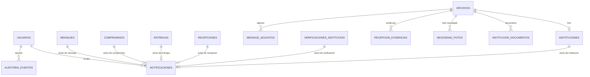

# Diagramas entidad-relación de DonaConecta

Versiones validadas en la Fase 05.1. Los nombres coinciden con `docs/diccionario-datos.md`.
Son diagramas de diseño: **no implican tablas creadas**.

## 1. Cómo visualizar los diagramas

- **GitHub:** los bloques `mermaid` se renderizan automáticamente al abrir el archivo `.md`.
- **VS Code:** usar una extensión de vista previa de Mermaid (por ejemplo, *Markdown Preview
  Mermaid Support*) o el comando `Markdown: Open Preview`. Si no hay extensión, el código
  permanece legible como texto y puede pegarse en <https://mermaid.live> para revisarlo.
- **Sustentación:** conviene abrir primero el diagrama general y luego el módulo que se explique.

## 2. Diagrama general

```mermaid
erDiagram
    USUARIOS ||--o{ USUARIO_ROLES : "tiene"
    ROLES ||--o{ USUARIO_ROLES : "asigna"
    ROLES ||--o{ ROL_PERMISOS : "incluye"
    PERMISOS ||--o{ ROL_PERMISOS : "pertenece"
    USUARIOS ||--o| DONANTES : "perfil opcional"
    USUARIOS ||--o{ TOKENS_SEGURIDAD : "posee"
    USUARIOS ||--o{ INSTITUCION_REPRESENTANTES : "representa"
    INSTITUCIONES ||--o{ INSTITUCION_REPRESENTANTES : "tiene"
    INSTITUCIONES ||--o{ VERIFICACIONES_INSTITUCION : "historial"
    INSTITUCIONES ||--o{ INSTITUCION_DOCUMENTOS : "documentos"
    INSTITUCIONES ||--o{ NECESIDADES : "publica"
    TIPOS_INSTITUCION ||--o{ INSTITUCIONES : "clasifica"
    DISTRITOS ||--o{ DONANTES : "ubica"
    DISTRITOS ||--o{ INSTITUCIONES : "ubica"
    ARCHIVOS ||--o| INSTITUCIONES : "foto principal"
    ARCHIVOS ||--o{ INSTITUCION_DOCUMENTOS : "documento"
    CATEGORIAS_BIENES ||--o{ PRODUCTOS : "agrupa"
    PRODUCTOS ||--o{ PRODUCTO_UNIDADES : "unidades validas"
    UNIDADES_MEDIDA ||--o{ PRODUCTO_UNIDADES : "define"
    NECESIDADES ||--o{ NECESIDAD_PRODUCTOS : "incluye"
    PRODUCTO_UNIDADES ||--o{ NECESIDAD_PRODUCTOS : "restringe"
    NECESIDADES ||--o{ NECESIDAD_FOTOS : "ilustra"
    ARCHIVOS ||--o{ NECESIDAD_FOTOS : "foto"
    NECESIDADES ||--o{ COMPROMISOS : "recibe"
    USUARIOS ||--o{ COMPROMISOS : "ofrece"
    COMPROMISOS ||--o{ COMPROMISO_PRODUCTOS : "detalla"
    COMPROMISOS ||--o{ COMPROMISO_HISTORIAL : "traza"
    COMPROMISOS ||--o{ ENTREGAS : "se concreta"
    ENTREGAS ||--o{ ENTREGA_PRODUCTOS : "transporta"
    ENTREGAS ||--o{ ENTREGA_HISTORIAL : "traza"
    ENTREGAS ||--o| RECEPCIONES : "confirma"
    RECEPCIONES ||--o{ RECEPCION_PRODUCTOS : "registra"
    RECEPCIONES ||--o{ RECEPCION_EVIDENCIAS : "evidencia"
    ARCHIVOS ||--o{ RECEPCION_EVIDENCIAS : "archivo"
    INSTITUCIONES ||--o{ PUNTOS_ACOPIO : "administra"
    DISTRITOS ||--o{ PUNTOS_ACOPIO : "ubica"
    PUNTOS_ACOPIO ||--o{ PUNTOS_ACOPIO_HORARIOS : "atiende"
    ENTREGAS ||--o| SESIONES_GPS : "comparte"
    SESIONES_GPS ||--o| GPS_ULTIMA_UBICACION : "posicion"
    USUARIOS ||--o{ SESIONES_GPS : "consiente"
    CONVERSACIONES ||--o{ CONVERSACION_PARTICIPANTES : "incluye"
    USUARIOS ||--o{ CONVERSACION_PARTICIPANTES : "participa"
    CONVERSACIONES ||--o{ MENSAJES : "contiene"
    USUARIOS ||--o{ MENSAJES : "envia"
    MENSAJES ||--o{ MENSAJE_ADJUNTOS : "adjunta"
    ARCHIVOS ||--o{ MENSAJE_ADJUNTOS : "archivo"
    MENSAJES ||--o{ REPORTES_MENSAJE : "reporta"
    USUARIOS ||--o{ NOTIFICACIONES : "recibe"
    USUARIOS ||--o{ AUDITORIA_EVENTOS : "ejecuta"
```

`PARAMETROS_SISTEMA` no se dibuja como relación: es configuración global consultada por los
servicios, no dependencia de una fila de negocio.

## 3. Usuarios, roles y permisos

## 4. Instituciones y representantes

## 5. Necesidades, productos y categorías

## 6. Compromisos, entregas y recepciones

## 7. Puntos de acopio y GPS

## 8. Conversaciones, participantes y mensajes

## 9. Notificaciones, archivos y auditoría

## 10. Cardinalidades resumidas

| Relación | Cardinalidad | Opcionalidad relevante |
|---|---|---|
| Usuario ↔ Rol | N:M | Toda cuenta activa tiene al menos un rol; `ADMINISTRADOR` solo por asignación administrativa. |
| Rol ↔ Permiso | N:M | Conjunto limitado a permisos necesarios. |
| Usuario ↔ Donante | 1:0..1 | Perfil solo para quien eligió donar. |
| Usuario ↔ Institución | N:M vía representantes | El vínculo puede estar `PENDIENTE`, `ACTIVO`, `INACTIVO` o `RETIRADO`. |
| Institución ↔ Necesidad | 1:N | Solo instituciones verificadas publican. |
| Necesidad ↔ Producto/Unidad | N:M | Toda línea usa una combinación producto-unidad válida. |
| Necesidad ↔ Compromiso | 1:N | La reserva se calcula, no se guarda. |
| Compromiso ↔ Entrega | 1:N | Entregas parciales o una total. |
| Entrega ↔ Recepción | 1:0..1 | `UNIQUE (entrega_id)`. |
| Entrega ↔ Sesión GPS | 1:0..1 | Máximo una sesión `ACTIVA` por entrega y por usuario. |
| Conversación ↔ Participante | N:M | Participación explícita; se puede suspender o retirar. |
| Mensaje ↔ Archivo | N:M | Adjuntos privados. |
| Notificación ↔ Recurso | 0..1 | Cero recursos para avisos de seguridad/cuenta; máximo uno para avisos de negocio. |
